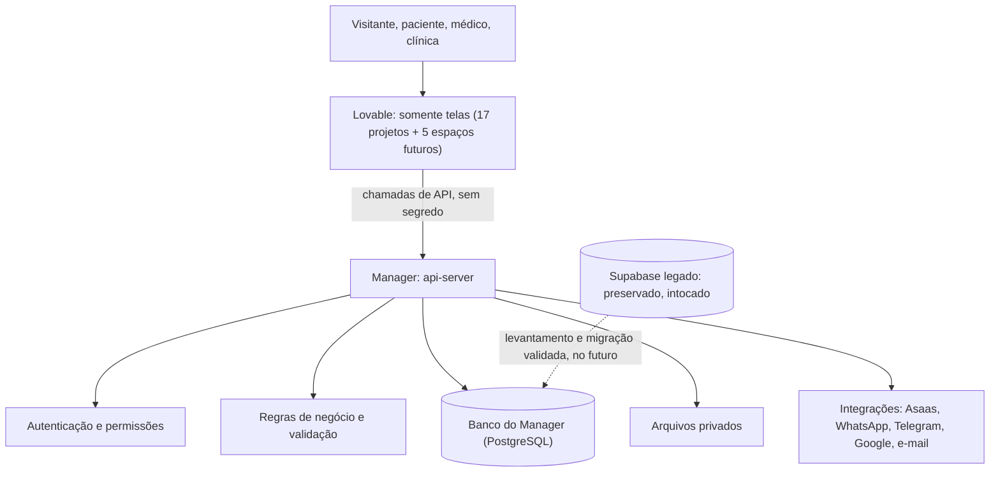
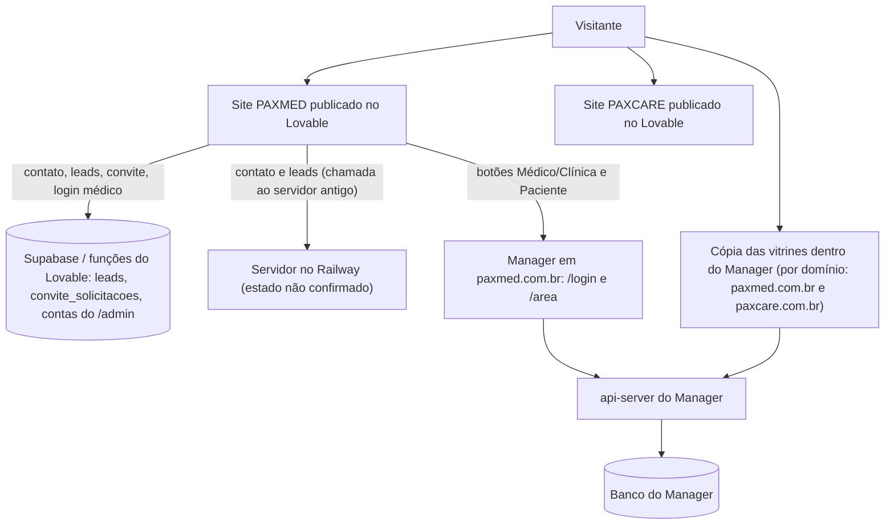

# Arquitetura dos sites: Lovable (tela) e Manager (backend)

Documento interno. Data da verificação: 27/11/2026. Não contém credenciais nem dados pessoais.
Contratos de rotas: [contratos-telas-manager.md](contratos-telas-manager.md).

## 1. Decisão do Dr. Caio

> "Todo backend é do Manager e o Lovable vai ficar responsável somente pelo front-end que é a tela."

| Papel | Dono | Responsabilidade |
|---|---|---|
| Apresentação visual | Lovable | Telas, textos de apresentação, imagens, animações, layout, idiomas |
| Backend | Manager | Servidor, regras de negócio, validação, permissões |
| Autenticação | Manager | Login de profissional, sessão do paciente, recuperação de senha |
| Dados | Manager | Único banco de gravação para sistemas novos e futuros |
| Integrações | Manager | Pagamentos, mensagens, agenda, arquivos privados, IA |

Regras que decorrem da decisão:

1. O Lovable não cria banco alternativo. Nenhuma tabela nova, função de servidor ou autenticação própria para dados novos.
2. Chaves e segredos ficam no Manager. Nunca no código da tela.
3. A gravação simultânea nos dois bancos (Lovable e Manager) foi proposta e NÃO foi adotada.
4. Os dados e serviços legados (Supabase, Railway antigo) são preservados. Nada é desligado, excluído, migrado ou alterado sem validação e ordem escrita do Dr. Caio.
5. Nada é publicado e nenhum domínio é alterado por este documento.

## 2. Organograma

### 2.1 Estado desejado (decidido, ainda não concluído)

### 2.2 Funcionamento atual (verificado no código em 27/11/2026)

Lido assim:

| Ponto | Hoje |
|---|---|
| Quem grava convites no site Lovable | O próprio Lovable (Supabase), sem passar pelo Manager |
| Quem grava contatos no site Lovable | Duas gravações: Supabase e Manager. Sucesso na tela depende só do Supabase |
| Login de médico no site Lovable | Chama o servidor no Railway; sessão guardada no navegador do Lovable |
| Login de paciente no site Lovable | Chama uma rota que não existe no Manager (ver contratos) |
| Cópia das vitrines no Manager | Existe no código, ativa só por domínio e caminho. Domínios ainda não apontados (decisão do Dr. Caio) |

## 3. Catálogo dos sites Lovable (fonte: PR 1 de caio-padua/SITES-LOVABLE, 27/11/2026)

Um link abre o projeto original; não é cópia do código. Só o PAXMED tem código confirmado no repositório de catálogo (commit `a31a42af`). As demais cópias e sincronizações estão pendentes.

| Nº | Projeto | Situação no Lovable | Código em SITES-LOVABLE | Link do projeto |
|---|---|---|---|---|
| 01 | PAXMED | Publicado | Na raiz | https://lovable.dev/projects/eb745d14-e232-4648-83f2-896318deef79 |
| 02 | PAXCARE | Publicado | Cópia pendente (versão observada `88f457e2`) | https://lovable.dev/projects/dea1937b-ef36-4d07-a9ed-bba601c30494 |
| 03 | Gabriela Severo | Não publicado | Pendente | https://lovable.dev/projects/5ed950ff-8cd0-403d-8fe8-f58b66365278 |
| 04 | Dr. Caio Padua's Hub | Não publicado | Pendente | https://lovable.dev/projects/a8a034f4-7190-4a5b-94ff-9d17cb9411de |
| 05 | Cícero João: Progresso em Ação | Publicado | Pendente | https://lovable.dev/projects/417e5491-c0af-493a-9c30-d9bd35d36c25 |
| 06 | CARLUCIA SITE | Não publicado | Pendente | https://lovable.dev/projects/a182a3a0-93d3-4eef-a341-5fd59152eb81 |
| 07 | Portfolio Compass | Não publicado | Pendente | https://lovable.dev/projects/94bf9438-e0cf-4d99-9fc8-16f2d6700204 |
| 08 | Patrium Flow | Não publicado | Pendente | https://lovable.dev/projects/cb901902-a922-42ff-a401-3705fe37a03d |
| 09 | Core Allocation Matrix | Não publicado | Pendente | https://lovable.dev/projects/da97aa1b-2446-472d-a744-a085977bf206 |
| 10 | Patrium Command Center | Não publicado | Pendente | https://lovable.dev/projects/3ab986e7-b531-4235-b23e-056695d63898 |
| 11 | Property Insight | Não publicado | Pendente | https://lovable.dev/projects/49a434fc-13d8-4235-82da-74b63b33aeb6 |
| 12 | Daiana's Authority Platform | Publicado | Pendente | https://lovable.dev/projects/acc95ac0-0ad9-4f27-9d72-56a03a74abb5 |
| 13 | Aurelian Med | Não publicado | Pendente | https://lovable.dev/projects/d39a2052-dba2-4a32-a880-ec272076d068 |
| 14 | Golden Gateway Entry | Não publicado | Pendente | https://lovable.dev/projects/08507615-fcbe-446f-93b7-e91d4b7bed40 |
| 15 | PAWARDS Elevated Return | Não publicado | Pendente | https://lovable.dev/projects/a7eaf90c-4034-42ec-b0cf-0b0a27226cad |
| 16 | Medcore Gateway | Não publicado | Pendente | https://lovable.dev/projects/989def3e-50f6-45e0-beb7-68f0b048b34a |
| 17 | PAWARDS MEDCORE: Nova Lux | Não publicado | Pendente | https://lovable.dev/projects/4d8fc6f9-75de-44f3-8366-777ea6e725ba |

### Cinco espaços futuros

| Espaço | Projeto | Situação | Observação |
|---|---|---|---|
| 18 | Futuro site 01 | Reservado | Nome, finalidade e domínio a definir pelo Dr. Caio |
| 19 | Futuro site 02 | Reservado | Idem |
| 20 | Futuro site 03 | Reservado | Idem |
| 21 | Futuro site 04 | Reservado | Idem |
| 22 | Futuro site 05 | Reservado | Idem |

Para cada site novo, preencher: nome, finalidade, projeto Lovable, localização do código, versão conferida, estado da sincronização e lista de rotas do Manager que a tela usa.

Não verificado nesta rodada: o conteúdo dos projetos 03 a 17 (se têm formulário, login ou banco próprio). O inventário de cada um é o primeiro passo antes de qualquer migração.

## 4. O que foi verificado: contatos, leads, convites, login, planos e cofre

Legenda: EXISTE = rota e tabela no código do Manager. ILUSTRATIVO = tela sem dado real. TESTADO = executado com dados sintéticos nesta sessão. PENDENTE = não feito.

| Tema | Existe no Manager | Ilustrativo | Testado | Pendente |
|---|---|---|---|---|
| Contato PAXMED | EXISTE: `POST /api/vitrine-contatos` (público, limite 5/min por IP), lista e marca de contato para colaborador | Nada | Não executado nesta sessão | Envio real a partir do Lovable; evitar duplicidade; consentimento não é gravado |
| Leads (portão de demonstração) | EXISTE: `POST /api/vitrine-leads`; mesmo CPF no mesmo tipo soma acessos | Liberação do portão é local no navegador do Lovable | Não executado nesta sessão | Contrato de campos com o Lovable; consentimento no servidor |
| Convite PAXMED | EXISTE: `POST /api/vitrine-convites`, `POST /api/vitrine-convites/status`, tela do CEO `/convites-paxmed` | Nada | TESTADO: 5 testes em banco descartável e 1 teste de navegador (desktop e celular), todos verdes | Convites já existentes no Supabase (não migrados); aviso ao CEO (tarefa 848) |
| Login de profissional | EXISTE: `POST /api/collaborator/login`, recuperação em `/collaborator/password-recovery/request` e `/complete` | Nada | Não executado nesta sessão | Compatibilidade de formato com o Lovable; cabeçalho `X-Request-Id` e origens do Lovable não aceitos (verificado em resposta local) |
| Login de paciente | EXISTE: `POST /api/area-paciente/login` e sessão em `/api/area-paciente/sessao/*` | A aba Paciente do `/login` do Lovable chama `POST /api/patient/login`, que NÃO existe no Manager | Não executado | Alinhar a tela do Lovable às rotas reais |
| Planos PaxCare | EXISTE: cadastro pelo dono (`/api/paxcare/planos`), listagem e assinatura pelo paciente (`/api/area-paciente/paxcare/planos` e `/assinatura`). Cobrança fica em `pendente_integracao` (sem cobrança automática) | Botões de plano na vitrine PAXCARE são prévia | Não executado nesta sessão | Cobrança real, fora do escopo |
| Cofre e compartilhamento | EXISTE: cofre do paciente, vínculo com clínica por categoria, revogação, leitura da clínica só do que foi compartilhado (`routes/paxcare.ts`) | Cofre e compartilhamento mostrados em `/` e `/medicos` do PAXCARE no Lovable são demonstração local | Não executado nesta sessão | Convite do médico pessoa física em `/medicos`: não existe rota |

Outras observações:

- O Lovable informa que confirma sucesso do contato só pelo banco dele e ignora falha do Manager. Isso não prova recebimento no Manager.
- O rodapé de `/area` mostra retorno institucional para um endereço de marca antiga (observação do Lovable, a confirmar).
- Não foi verificado: o Railway, o Supabase, o Lovable publicado e o DNS.

## 5. Dados e preservação (Supabase e legados)

Regra: preservar, levantar, planejar, validar. Nada de apagar, desligar ou alterar.

| Passo | Ação | Quem decide |
|---|---|---|
| 5.1 | Levantar o inventário do que existe no Supabase: tabelas, quantidade de linhas, datas, sem copiar dado pessoal para documentos | Dr. Caio autoriza; leitura apenas |
| 5.2 | Pedir exportação ao responsável do Lovable em arquivo, fora do Git | Dr. Caio |
| 5.3 | Importar em banco descartável do Manager e conferir contagem, protocolos repetidos e e-mails repetidos | Agente, com dados sintéticos primeiro |
| 5.4 | Relatório de validação (o que entrou, o que ficou de fora, duplicidades) | Agente |
| 5.5 | Migração real, só com ordem escrita e cópia de segurança | Dr. Caio |
| 5.6 | Desligar o legado, só depois de período de conferência | Dr. Caio |

Pontos de atenção:

1. Protocolo de convite `PXM-XXXX-XXXX` existe nos dois sistemas. Na importação, protocolo igual não pode virar registro duplicado nem trocar de dono.
2. Contas do `/admin` do Lovable são do serviço de autenticação do Supabase. Senhas não migram; os usuários passam a ser profissionais do Manager.
3. Consentimento: o Lovable não envia consentimento ao servidor. Registros antigos entram marcados como "consentimento não comprovado".

## 6. Como acomodar cada site sem quebrar o sistema

| Site | O que pode ser feito já | O que depende de decisão ou levantamento |
|---|---|---|
| PAXMED | Manter a tela no Lovable. Botões de acesso já apontam ao Manager. Contrato de rotas escrito | Ajuste de `X-Request-Id`/origens no Manager; aba Paciente; destino único do convite |
| PAXCARE | Manter a tela no Lovable. Cofre, vínculos e planos já existem no Manager | Convite do médico pessoa física (projeto novo); cópia do código no GitHub |
| Demais 15 projetos | Inventariar | Ver se usam banco, login ou formulário próprio |
| Cinco futuros | Reservar identificação | Nomes, domínios, rotas |

Cada site novo usa só rotas do Manager, com origem permitida cadastrada, sem segredo no navegador.

## 7. Pendências gerais

1. Autorização para ajustar o servidor (`X-Request-Id`, origem da prévia do Lovable). Não alterado.
2. Levantamento do Supabase e dos 15 projetos restantes.
3. Contrato formal em OpenAPI (hoje só a descrição em texto).
4. Testes de ponta a ponta com dados sintéticos: contato, leads, login, cofre, vínculo.
5. Apontamento de domínios e publicação: do Dr. Caio.

## 8. Cartas e documentos relacionados no repositório

- `cartas/2026-07-27_DR-LOVABLE_*` (cartas antigas à equipe Lovable)
- `docs/vitrines-botoes-inventario.md` (botões das vitrines dentro do Manager)
- `docs/arquitetura/contratos-telas-manager.md` (este conjunto)

RESUMO EM 1 LINHA: o Lovable desenha as telas, o Manager é dono de tudo que não é tela, e o legado fica intacto até migração validada.
