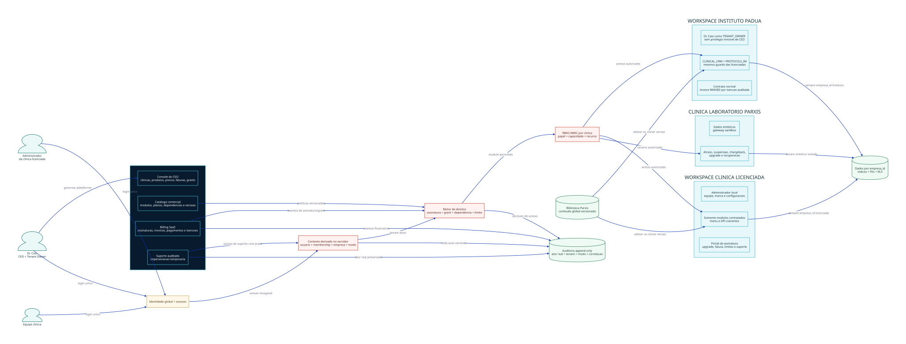
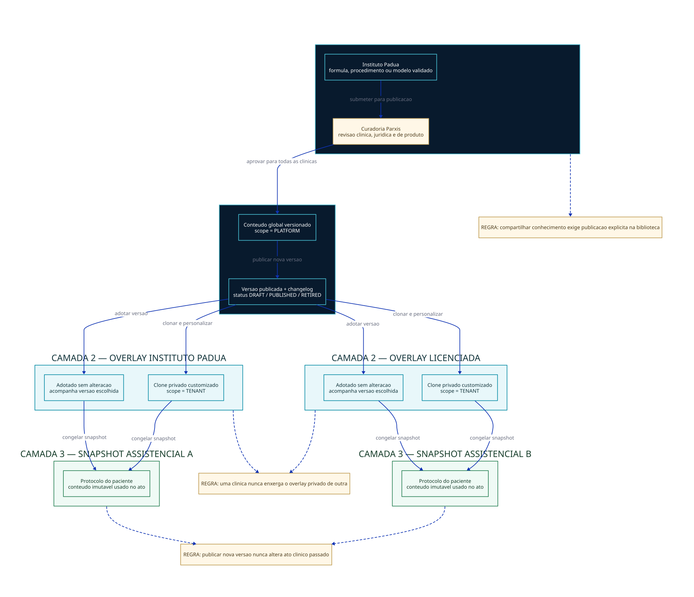

# PARXIS SaaS multi-tenant modular — especificação-mestra v1

**Status:** PROPOSTA PARA VALIDAÇÃO DO CEO — NÃO AUTORIZA IMPLEMENTAÇÃO
**Data:** 17/07/2026
**Autor:** Manus AI
**Produto:** Parxis, anteriormente Paxter
**Repositório:** `caio-padua/Protocolo-Manager`

## 1. Decisão executiva

O Parxis deve evoluir como **uma única plataforma SaaS multi-tenant**, e não como uma cópia do sistema para cada clínica. O Instituto Pádua continuará sendo uma clínica operacional real dentro da plataforma, usando os mesmos fluxos, contratos, módulos, guardas e limites das clínicas licenciadas. A diferença financeira será uma **isenção explícita e auditada**, nunca um privilégio oculto nem um pagamento fictício.

A plataforma será dividida em dois contextos visíveis. O **Workspace da Plataforma Parxis** servirá ao CEO para administrar clínicas, produtos, preços, assinaturas, faturas, concessões, suporte e auditoria. O **Workspace da Clínica** servirá ao atendimento, pacientes, equipe, protocolos, agenda, documentos e financeiro clínico. A identidade pessoal poderá ser a mesma, mas a sessão, o papel e os poderes serão distintos.

> **Regra central:** papel de CEO não equivale a poder clínico dentro de qualquer tenant. Para operar o Instituto Pádua, o Dr. Caio entra como `TENANT_OWNER`; para suporte em outra clínica, abre uma sessão temporária, justificada e auditada.

## 2. Objetivos e limites

Esta arquitetura deve permitir que cada clínica seja autônoma e, simultaneamente, se beneficie do conhecimento e dos motores construídos no Instituto Pádua. A autonomia inclui equipe, papéis, marca, agenda, configurações, integrações, catálogos privados, protocolos próprios, cobranças de pacientes e dados. A plataforma controla identidade, segurança, isolamento, catálogo comercial, biblioteca Parxis publicada, limites, cobrança SaaS, suporte e auditoria.

| Objetivo | Resultado verificável |
|---|---|
| Isolar clínicas | Nenhuma consulta, arquivo, busca ou exportação de uma clínica retorna dados de outra |
| Comercializar módulos | Menu e API refletem contratos, concessões, dependências, limites e permissões |
| Preservar o Instituto Pádua | Operação clínica segue funcionando durante a migração, sem depender de ID fixo |
| Experimentar como licenciado | Instituto percorre contratação, ativação, upgrade, downgrade e bloqueio como cliente comum |
| Testar falhas sem risco | Clínica Laboratório usa dados sintéticos e gateway sandbox |
| Compartilhar conhecimento | Conteúdo útil vira versão da Biblioteca Parxis após curadoria; nada privado é copiado automaticamente |
| Cobrar corretamente | Financeiro SaaS fica separado do financeiro dos pacientes |
| Trabalhar com o executor | Toda missão passa por especificação, resposta com evidências, aprovação e autorização explícita |

Não fazem parte desta primeira autorização a execução de migrações em produção, a ativação de gateway real, a inclusão de clínicas com prontuários reais, a definição de preços comerciais ou a reescrita integral do produto.

## 3. Diagnóstico confirmado no repositório

A base já contém `empresas`, hierarquia de licenciamento, contratos, módulos em JSONB, tela de pirâmide e um `moduleGuard`. Entretanto, o contexto de tenant atual é fixado no backend, o guard modular não protege o conjunto real de rotas e a autenticação profissional não carrega vínculo seguro com clínica.[2] [3] [4] [9] O frontend possui uma matriz de permissões e lógica de menu, mas essa camada não substitui autorização no servidor.[5]

A análise estática reproduzível detectou **121 tabelas Drizzle**; apenas **12 possuem `empresa_id` direto**. As 109 restantes incluem tanto tabelas realmente globais quanto raízes e filhas operacionais ainda sem escopo explícito, razão pela qual não se deve adicionar a coluna indiscriminadamente.[1]

| Área atual | Ativo reaproveitável | Lacuna que impede SaaS seguro |
|---|---|---|
| `empresas` | Tenant, hierarquia e dados cadastrais | Mistura clínica, plataforma e contrato; compatibilidade `NULL = Instituto` não pode permanecer |
| Identidade | Profissionais, colaboradores e cargos | Credencial pessoal e papel por clínica não formam uma identidade global N:N |
| Tenant | Middleware existente | Tenant vem de regra fixa/implícita, não de sessão e vínculo |
| Módulos | JSONB e `moduleGuard` | Falha aberta e ausência de cobertura efetiva das rotas |
| Menu | Navegação e permissões visuais | Recurso oculto ainda pode ser chamado diretamente pela API |
| Conteúdo clínico | Fórmulas, injetáveis, motores e protocolos | Biblioteca Parxis, conteúdo privado e snapshot assistencial estão misturados |
| Financeiro clínico | `payments` e adaptador Asaas | Não existe domínio separado para assinaturas e faturas SaaS |
| Console CEO | Pirâmide e KPIs | Receita é projeção; faltam ledger, pagamento, concessão, suporte e auditoria |
| Engenharia | Monorepo e scripts | Typecheck falha, há pouquíssimos testes e não existe gate contínuo suficiente |
| Segurança | Alguns tokens e guards locais | Certificados A1 foram versionados; rotas clínicas abertas e ausência de barreiras globais exigem contenção imediata |

As Specs A e B existentes devem ser tratadas como **protótipos úteis**, não como arquitetura final. A regra `locations.empresa_id NULL = tenant padrão`, o `isPlatformOwner` como atalho e a receita calculada no frontend precisam ser substituídos gradualmente.[7] [8]

## 4. Modelo de tenancy e identidade

`empresas` continuará sendo a entidade canônica de clínica/tenant. Não será criada uma tabela concorrente chamada `clinicas`. A organização legal que opera o Parxis poderá existir como entidade de faturamento da plataforma, mas o Workspace da Plataforma não dependerá de fingir que essa organização é uma clínica.

| Entidade proposta | Responsabilidade |
|---|---|
| `usuarios` | Identidade global, e-mail normalizado, credencial, MFA, status e segurança |
| `membros_empresa` | Vínculo N:N entre pessoa e clínica, com estado e perfil local |
| `papeis_empresa` | Papéis configuráveis dentro do tenant |
| `permissoes` | Capacidades estáveis, como `protocol.read` e `protocol.write` |
| `papel_permissoes` | Capacidades atribuídas a cada papel |
| `membro_papeis` | Papéis efetivos do membro dentro de uma clínica específica |
| `sessoes_usuario` | Sessões revogáveis, dispositivo, MFA e contexto ativo |
| `papeis_plataforma` | Poderes do CEO, financeiro SaaS, suporte e auditoria; separados dos papéis clínicos |
| `sessoes_impersonacao` | Suporte temporário, motivo, escopo, aprovação, expiração e ator real |
| `eventos_auditoria` | Registro append-only de ator, tenant, modo, ação, recurso e resultado |

A clínica ativa nunca será aceita diretamente de `query`, `body`, header arbitrário ou `localStorage`. Um endpoint dedicado de troca de contexto validará o vínculo e emitirá uma nova sessão. Toda requisição autenticada resolverá no servidor `actorUserId`, `membershipId`, `empresaId`, `platformRole`, `accessMode` e `correlationId`.

### 4.1 Pipeline obrigatório de autorização

| Ordem | Barreira | Falha canônica |
|---:|---|---|
| 1 | Autenticação e sessão revogável | `AUTH_REQUIRED` |
| 2 | Vínculo ativo e tenant derivado | `TENANT_REQUIRED` |
| 3 | Estado contratual/assistencial | `SUBSCRIPTION_RESTRICTED` |
| 4 | Direito de uso do módulo | `ENTITLEMENT_REQUIRED` |
| 5 | Papel e capacidade do usuário | `CAPABILITY_FORBIDDEN` |
| 6 | Propriedade tenant-scoped do recurso | `RESOURCE_NOT_FOUND` ou negação equivalente |
| 7 | Feature flag de rollout | `FEATURE_UNAVAILABLE` |
| 8 | Handler e evento de auditoria | Resultado correlacionado |

Os guardas falham fechados. Se o banco ou o motor de direitos estiver indisponível, um módulo pago não será liberado por fallback.

## 5. Estratégia de dados

Entidades-raiz operacionais, como clientes, profissionais locais, agenda, protocolos, documentos, pagamentos clínicos e configurações, receberão `empresa_id NOT NULL`. Tabelas-filhas herdarão o tenant por pai e poderão repetir `empresa_id` quando isso for necessário a índices, chaves compostas ou RLS. Nenhuma entidade clínica poderá ser lida apenas por `id` sem validar o tenant.

| Classe | Exemplos | Regra |
|---|---|---|
| Global de plataforma | Módulos, capacidades, referências publicadas | Sem tenant; escrita restrita e versionada |
| Raiz de tenant | Cliente, agenda, profissional local, protocolo, pagamento | `empresa_id NOT NULL` e índice composto |
| Filha operacional | Item, sessão, anexo e histórico | Pai tenant-scoped; consistência garantida |
| Catálogo híbrido | Fórmula, injetável, documento e mensagem | `scope = PLATFORM|TENANT`, proprietário, origem e versão |
| Registro assistencial | Prescrição, protocolo aplicado e documento assinado | Snapshot imutável do conteúdo utilizado |
| Comercial SaaS | Assinatura, fatura, grant e uso | Escopo por tenant e acesso pela plataforma/portal próprio |

A migração seguirá **expandir → preencher → verificar → impor → limpar**. A coluna entra anulável, o backfill deriva a clínica de relações verificáveis e linhas ambíguas vão para quarentena. Somente após contagens, checksums, teste de reexecução e zero `NULL` entram `NOT NULL`, chaves e políticas de banco. A compatibilidade `NULL = Instituto Pádua` será temporária, observável e removida.

## 6. Biblioteca Parxis, clínica e ato assistencial

O conhecimento criado no Instituto Pádua pode se transformar em vantagem comercial sem replicar automaticamente informações privadas. A solução possui três camadas.

| Camada | Proprietário | Comportamento |
|---|---|---|
| Biblioteca Parxis | Plataforma | Conteúdo revisado, publicado, versionado e disponível às clínicas elegíveis |
| Overlay da clínica | Tenant | Adoção, clonagem, personalização, ocultação e precificação local |
| Snapshot assistencial | Registro do paciente | Cópia imutável do conteúdo efetivamente prescrito ou aplicado |

Quando o Instituto aprimorar uma fórmula ou protocolo, o item continuará privado até uma proposta de publicação. A curadoria clínica, técnica e jurídica compara versões, registra autoria e publica uma nova versão global. As licenciadas podem adotar, clonar ou ignorar. Nenhuma atualização sobrescreve automaticamente o overlay da clínica nem altera atos passados.

## 7. Catálogo comercial e motor de direitos

O sistema separará quatro perguntas independentes: **a clínica contratou**, **o usuário pode**, **como a clínica configurou** e **a versão técnica está liberada**. O JSON `empresas.modulosAtivos` será apenas uma fonte legada de migração e nunca a nova fonte canônica.

| Eixo | Fonte canônica |
|---|---|
| Entitlement | Assinatura, item contratado, trial, grant, isenção e estado financeiro |
| Permissão | Vínculo, papel, capacidade e atributo do recurso |
| Configuração | Preferências tenant-scoped do módulo |
| Feature flag | Política de rollout da plataforma |

### 7.1 Catálogo inicial

Os preços nascerão como versões em rascunho. Nenhum valor será codificado nesta fase.

| Código | Nome comercial | Dependência | Papel inicial |
|---|---|---|---|
| `PARXIS_CORE` | Núcleo Parxis | Nenhuma | Não faturável; identidade, segurança, tenant e auditoria |
| `CLIENT_REGISTRY` | Cadastro e Jornada do Paciente | `PARXIS_CORE` | Base comercial mínima |
| `INJECTABLE_PROTOCOLS` | Protocolos Injetáveis | `CLIENT_REGISTRY` | Produto-âncora para o primeiro piloto |
| `AGENDA_RECEPTION` | Agenda e Recepção | `CLIENT_REGISTRY` | Segunda expansão de uso diário |
| `CLINICAL_COCKPIT` | Cockpit Clínico | `CLIENT_REGISTRY` | Módulo premium |
| `FORMULA_PRESCRIPTION` | Fórmulas e Prescrição | `CLIENT_REGISTRY` | Add-on clínico |
| `DOCUMENT_ARSENAL` | Arsenal Documental | `CLIENT_REGISTRY` | Documentos e modelos |
| `DIGITAL_SIGNATURE` | Assinatura Digital | `DOCUMENT_ARSENAL` | Mensalidade e consumo externo |
| `STOCK_CONTROL` | Estoque Clínico | `INJECTABLE_PROTOCOLS` | Add-on operacional |
| `FINANCE_OPERATIONS` | Financeiro da Clínica | `PARXIS_CORE` | Cobranças de pacientes, separado do SaaS |
| `FISCAL_NFSE` | Fiscal e NFS-e | `FINANCE_OPERATIONS` | Add-on fiscal |
| `COMMUNICATION_HUB` | Comunicação | `CLIENT_REGISTRY` | Mensalidade e uso |
| `PATIENT_PORTAL` | Portal do Paciente | `CLIENT_REGISTRY` | Add-on de experiência |
| `MULTI_UNIT` | Gestão Multiunidade | `PARXIS_CORE` | Governança premium |
| `WHITE_LABEL` | Marca da Clínica | `PARXIS_CORE` | Personalização premium |

O primeiro produto comercial completo será **`CLIENT_REGISTRY` + `INJECTABLE_PROTOCOLS`**. Os demais menus continuarão internos até que dados, API, permissões e testes do respectivo módulo sejam certificados.

### 7.2 Estrutura de entitlement

| Tabela | Função |
|---|---|
| `saas_modules` | Módulos estáveis e seu ciclo de vida |
| `saas_capabilities` | Capacidades atômicas |
| `saas_module_capabilities` | Capacidades concedidas pelo módulo |
| `saas_module_dependencies` | Dependências e incompatibilidades |
| `saas_prices` | Preços versionados por vigência e periodicidade |
| `saas_plans` / `saas_plan_items` | Pacotes comerciais |
| `saas_subscriptions` / `saas_subscription_items` | Contrato e itens com preço congelado |
| `saas_entitlement_grants` | Trial, cortesia, isenção e override com validade |
| `saas_entitlement_events` | Ledger append-only de ativação, suspensão e restauração |
| `saas_usage_meters` / `saas_usage_events` | Limites e consumo idempotente |
| `feature_flags` / `feature_flag_targets` | Rollout técnico separado da compra |

O snapshot retornado ao frontend e usado pelo backend terá `allowed`, `reasonCode`, `source`, `validUntil`, `limits` e `entitlementsVersion`. O menu será gerado a partir da mesma configuração canônica das rotas, mas a API repetirá toda a decisão antes do handler.

## 8. Cobrança SaaS e financeiro clínico

O adaptador técnico de gateway pode ser reaproveitado, mas as cobranças de pacientes e a receita do Parxis permanecerão em domínios diferentes. A rota Asaas atual trata clientes e pagamentos clínicos; misturá-la a assinaturas SaaS criaria risco de conciliação e exposição entre tenants.[6]

| Domínio | Devedor | Credor | Núcleo de dados |
|---|---|---|---|
| Financeiro clínico | Paciente | Clínica | `clients`, `payments`, NFS-e e contas locais |
| Financeiro SaaS | Clínica | Operadora Parxis | billing account, subscription, invoice, payment e provider event SaaS |

O fluxo será: cotação versionada, aceite, assinatura pendente, fatura, checkout hospedado, persistência idempotente do webhook, reconciliação e criação de entitlement. O webhook não ativa diretamente dezenas de tabelas; primeiro grava o evento externo e depois um reconciliador aplica a máquina de estados.

### 8.1 Instituto Pádua sem pagamento fictício

| Elemento | Regra |
|---|---|
| Política | `INTERNAL_DOGFOOD` |
| Contrato | Normal, com módulos e preços de lista |
| Fatura | Gerada com linhas explicáveis |
| Ajuste | Isenção `FULL_WAIVER` ou crédito interno auditável |
| Estado final | `WAIVED`, nunca `PAID` |
| Direito de uso | `INTERNAL_GRANT` ou `WAIVED_INVOICE` |
| Auditoria | Autor, justificativa, escopo, início e validade |

A Clínica Laboratório, e não o Instituto Pádua, simulará atraso, pagamento, chargeback, suspensão e recuperação no gateway sandbox.

### 8.2 Continuidade assistencial

Inadimplência não apagará registros nem bloqueará indiscriminadamente a continuidade do cuidado. Em `PAST_DUE` há aviso; em carência o acesso permanece; na suspensão, módulos pagos entram em leitura quando seguro e novas operações são bloqueadas; no encerramento, core, exportação e retenção seguem a política clínica e legal aplicável.

## 9. Experiência do usuário e dogfooding

Após o login, o servidor lista apenas contextos autorizados. Quem possui um contexto entra diretamente; quem possui vários escolhe entre Plataforma Parxis, Instituto Pádua e clínicas permitidas. A troca gera nova sessão e evento de auditoria.

| Contexto | Como o Dr. Caio entra | O que sente |
|---|---|---|
| Plataforma Parxis | Papel de CEO | Produto, preços, clínicas, faturamento, suporte e auditoria |
| Instituto Pádua | `TENANT_OWNER` comum | O mesmo menu, limites, upgrades e bloqueios de uma licenciada |
| Clínica Laboratório | Membro autorizado | Falhas e cenários de cobrança sem prontuário real |
| Clínica licenciada | Somente por impersonação temporária | Experiência do cliente com banner, motivo e expiração |

O cabeçalho mostrará sempre clínica, marca e papel ativo. A impersonação terá banner permanente com ator real, tenant, motivo, expiração e botão para encerrar imediatamente.

### 9.1 Jornada da licenciada

| Etapa | Saída persistida |
|---:|---|
| Cadastro | Tenant e billing account em rascunho |
| Escolha de módulos | Cotação versionada |
| Simulação | Snapshot de preço, limites e vigência |
| Aceite | Termos e responsáveis auditáveis |
| Pagamento | Fatura e tentativa no gateway |
| Ativação | Assinatura e entitlements consistentes |
| Onboarding | Marca, equipe, unidades, agenda, integrações e catálogos |
| Operação | Workspace tenant-scoped com apenas o que pode ser usado |

## 10. Console do CEO

A tela atual da pirâmide será preservada como ponto de partida visual, mas passará a representar dados reais do domínio SaaS. O console será exclusivo do Workspace da Plataforma.

| Área | Funções |
|---|---|
| Visão geral | MRR recebido, inadimplência, trials, churn, módulos e alertas |
| Clínicas | Cadastro, contrato, status, saúde e acesso de suporte |
| Produtos | Módulos, dependências, capacidades, documentação e rollout |
| Planos e preços | Versões, pacotes, descontos e simulação |
| Assinaturas | Itens, upgrade, downgrade, cancelamento e histórico |
| Faturas | Cobranças, tentativas, conciliação, crédito e estorno |
| Concessões | Trial, cortesia, isenção, override e revogação |
| Impersonação | Motivo, escopo, prazo, aprovação e encerramento |
| Uso e saúde | Limites, armazenamento, erros, jobs e integrações |
| Auditoria | Linha do tempo das ações sensíveis |

Ativar módulo, conceder isenção, suspender clínica, entrar como suporte, alterar preço e reprocessar webhook exigirão justificativa e evento auditável. Preço novo cria versão; nunca reescreve o valor contratado anteriormente.

## 11. Migração segura

| Onda | Entrega | Gate de saída |
|---:|---|---|
| 0 | Revogação de segredos expostos, autenticação global, backup/restore e contenção | Nenhuma clínica externa; restauração comprovada |
| 1 | Migrações versionadas, inventário, correlação e auditoria | Baseline reproduzível |
| 2 | Identidade global, memberships, papéis e sessões | Troca de clínica segura |
| 3 | `empresa_id`, backfill, índices, FKs e queries tenant-scoped | Testes A↔B sempre negados |
| 4 | Biblioteca, overlay e snapshot | Histórico assistencial imutável |
| 5 | Catálogo, assinatura, grants, guardas e menu | URL e API bloqueadas sem direito |
| 6 | Console, contratos e ledger sem gateway real | Fluxo comercial reconciliado localmente |
| 7 | Instituto em dogfooding com fatura `WAIVED` | Zero bypass técnico |
| 8 | Gateway SaaS e webhooks idempotentes | Duplicação e reordenação testadas |
| 9 | Clínica Laboratório | Falhas controladas e recuperação comprovada |
| 10 | Piloto com `CLIENT_REGISTRY` + `INJECTABLE_PROTOCOLS` | Operação assistida e isolada |
| 11 | RLS, `NOT NULL` e retirada dos fallbacks | Segunda barreira de banco ativa |

Nenhuma onda avança sem especificação, migração em staging, revisão independente, testes, evidência de rollback e feature flag inicialmente desligada.

## 12. Bateria BLSTER

A validação combinará **Barreiras, Licenças, Sessões, Tenants, Entitlements e Recuperação**. O objetivo é testar semântica e falhas, não apenas renderização de tela.

| Cenário | Resultado obrigatório |
|---|---|
| Menu oculto e URL digitada | `ENTITLEMENT_REQUIRED`, nenhum dado retornado |
| Módulo contratado, usuário sem capacidade | `CAPABILITY_FORBIDDEN` |
| Usuário autorizado, clínica sem módulo | Licença prevalece; acesso negado |
| CEO chama endpoint clínico sem contexto | Acesso negado |
| Impersonação válida | Banner, expiração e ator real auditados |
| Navegador envia outro `empresaId` | Valor rejeitado ou ignorado |
| Instituto recebe isenção | Fatura `WAIVED`; nunca `PAID` |
| Módulo é desativado | Novas ações bloqueadas; histórico preservado |
| Catálogo recebe nova versão | Snapshot antigo permanece idêntico |
| Webhook chega dez vezes | Um único efeito financeiro e de entitlement |
| Webhook chega fora de ordem | Máquina de estados impede regressão |
| Motor de entitlement falha | Acesso falha fechado |
| Arquivo de outro tenant tem URL conhecida | Download negado e tentativa auditada |
| Backfill é reexecutado | Nenhuma duplicação ou mudança indevida |
| Backup é restaurado | Contagens, checksums e relações conferem |

## 13. Parxis Bridge: colaboração com o agente executor

Foi criada uma ponte local e versionada em `.agents/bridge/`, com utilitário em `tools/parxis-bridge/cli.mjs`. A missão canônica é JSON, a carta Markdown ASCII é gerada automaticamente e o fluxo impede `BUILD_AUTHORIZED` antes de `APPROVED`. Somente o CEO pode autorizar construção.[10]

| Estado | Responsável típico |
|---|---|
| `DRAFT` | Manus prepara especificação e missão |
| `READY_FOR_REPLIT` | Replit recebe análise ou implementação autorizada |
| `REPLIT_WORKING` | Executor examina código e reúne evidências |
| `NEEDS_MANUS_REVIEW` | Manus confronta resposta com a spec e o repositório |
| `NEEDS_CEO_DECISION` | Uma pergunta decisória por vez |
| `APPROVED` | Arquitetura aceita, ainda sem autorização de código |
| `BUILD_AUTHORIZED` | CEO autoriza construção explicitamente |
| `IMPLEMENTED` | Executor devolve arquivos e testes |
| `VERIFIED` / `CLOSED` | Revisão independente e encerramento |

O Artigo 69 foi promulgado no Código Paxter para tornar esse método uma regra durável. A ferramenta foi testada com criação, fila, resposta, validação e bloqueio de autorização prematura.

## 14. Primeira missão recomendada

A primeira missão ao executor será **somente análise e contenção**, sem alteração de código. Ela deverá confirmar o Gate 0, mapear todas as rotas clínicas abertas, propor a retirada do tenant fixo e preparar migrações versionadas. Nenhum módulo comercial deve ser construído antes disso.

| Critério de aceite | Evidência |
|---|---|
| Matriz de rotas | Método, caminho, autenticação, tenant, entitlement e capacidade |
| Segredos | Revogação/rotação confirmada sem revelar valores |
| Tenant | Lista de usos de ID fixo, fallback e parâmetros não confiáveis |
| Migração | Plano aditivo, backup, rollback e quarentena |
| Testes | Casos negativos A↔B e chamadas diretas de API |
| Recomendação | Declaração objetiva sobre autorização ou bloqueio da próxima onda |

## 15. Primeiro marco comercial

O objetivo inicial não é disponibilizar todo o menu. É colocar **uma clínica piloto isolada** em operação com `CLIENT_REGISTRY` e `INJECTABLE_PROTOCOLS`, contrato e fatura corretos, suporte auditado, exportação testada e dados impossíveis de cruzar com o Instituto Pádua.

Antes desse marco, o Instituto usará o mesmo pacote em dogfooding e a Clínica Laboratório executará as falhas. Isso permite aperfeiçoar o produto enquanto o Dr. Caio trabalha, sem transformar o atendimento real em ambiente de experimentação destrutiva.

## 16. Decisões solicitadas ao CEO

| Ordem | Decisão | Recomendação de Manus |
|---:|---|---|
| 1 | Aprovar esta arquitetura como direção oficial | **Aprovar com execução por ondas** |
| 2 | Autorizar a primeira missão de análise do Gate 0 | **Autorizar análise, sem código ainda** |
| 3 | Confirmar o produto-âncora | **`CLIENT_REGISTRY` + `INJECTABLE_PROTOCOLS`** |
| 4 | Confirmar que Instituto usa `WAIVED`, nunca pagamento falso | **Confirmar** |
| 5 | Confirmar separação Plataforma × Clínica | **Confirmar** |
| 6 | Definir preços | **Adiar até inventário de custo e proposta de valor** |

A validação deve ocorrer uma decisão por vez. A primeira pergunta é: **o CEO aprova esta arquitetura como direção oficial, permitindo que a missão de Gate 0 seja enviada ao Dr. Replit apenas para análise e evidências, sem autorização de construção?**

## Referências

[1]: anexos/evidencias/tenant-schema-summary-manager.txt "Resumo reproduzível da análise de escopo por tenant"
[2]: https://github.com/caio-padua/Protocolo-Manager/blob/main/lib/db/src/schema/empresas.ts "Schema atual de empresas e licenciamento"
[3]: https://github.com/caio-padua/Protocolo-Manager/blob/main/artifacts/api-server/src/middleware/tenantContext.ts "Middleware atual de contexto de tenant"
[4]: https://github.com/caio-padua/Protocolo-Manager/blob/main/artifacts/api-server/src/middleware/moduleGuard.ts "Guard atual de módulos"
[5]: https://github.com/caio-padua/Protocolo-Manager/blob/main/artifacts/padcom/src/lib/permissoes.ts "Matriz atual de permissões do frontend"
[6]: https://github.com/caio-padua/Protocolo-Manager/blob/main/artifacts/api-server/src/routes/asaas.ts "Integração Asaas atual do domínio clínico"
[7]: https://github.com/caio-padua/Protocolo-Manager/blob/main/specs/saas-onda-a-schema-piramide.md "Spec A atual da pirâmide SaaS"
[8]: https://github.com/caio-padua/Protocolo-Manager/blob/main/specs/saas-onda-b-centro-comando.md "Spec B atual do Centro de Comando"
[9]: https://github.com/caio-padua/Protocolo-Manager/blob/main/lib/db/src/schema/professionals.ts "Schema atual de profissionais"
[10]: anexos/parxis-bridge-colaboracao.md "Especificação do Parxis Bridge"

**RESUMO EM 1 LINHA:** o Parxis será uma plataforma única, modular e isolada por clínica, com o Instituto Pádua operando como licenciado real por isenção auditada e cada mudança executada por ondas verificáveis através do Parxis Bridge.
