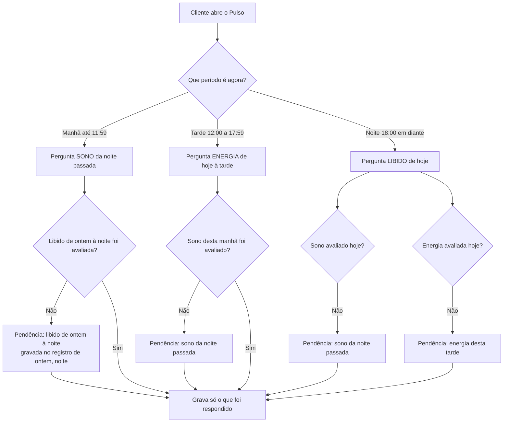

# PG-01 · Pulso Diário: uma nota por período

Decidido pelo Dr. Caio em 22/11/2026. Fuso: Brasília.

## 1. Regra em uma tabela

| Período | Horário do lembrete | Nota principal | A que momento se refere | Pendências que reaparecem |
|---|---|---|---|---|
| Manhã | 08:00 | Sono | Noite passada (de ontem para hoje) | Libido de ontem à noite |
| Tarde | 15:00 | Energia | Hoje à tarde | Sono da noite passada |
| Noite | 20:00 | Libido | Hoje | Sono da noite passada; energia desta tarde |

Pressão, frequência cardíaca e glicemia continuam disponíveis em todos os períodos.

## 2. Organograma

## 3. Prazos (o que NÃO volta)

| Nota | Prazo para responder | Depois do prazo |
|---|---|---|
| Sono | Até 23:59 do mesmo dia | Não pode mais ser avaliado |
| Energia | Até 23:59 do mesmo dia | Não pode mais ser avaliada |
| Libido | Até 11:59 do dia seguinte | Perde o prazo. Resposta dada à tarde vale para o próprio dia, não para a noite anterior |

## 4. Textos das mensagens (sempre dizem a que momento a nota se refere)

| Situação | Texto |
|---|---|
| Sono (manhã) | Como foi o seu sono na noite passada (de 21/11 para 22/11)? Dê uma nota de 0 a 10. |
| Energia (tarde) | Como está a sua energia hoje à tarde (22/11)? Dê uma nota de 0 a 10. |
| Libido (noite) | Como está a sua libido hoje, 22/11? Dê uma nota de 0 a 10. Responder é opcional. |
| Sono pendente | Você não avaliou o sono da noite passada (de 21/11 para 22/11). Avalie agora. |
| Energia pendente | Você não avaliou a sua energia desta tarde (22/11). Avalie agora. |
| Libido pendente | Você não avaliou a sua libido de ontem à noite (21/11). Avalie agora: depois desta manhã esse prazo termina. |

## 5. Lembrete automático pelo Telegram

| Item | Valor |
|---|---|
| Chave de liga/desliga | `pulso.lembrete.modo` = desligado, lista ou ligado |
| Quem recebe no modo lista | `pulso.lembrete.permitidos` (ids de cliente). Hoje: 11 e 12 |
| Horários | `pulso.lembrete.horarios` (padrão 08:00, 15:00, 20:00) |
| Tolerância | Envia no horário ou até 10 minutos depois, nunca antes |
| Repetição | No máximo um lembrete por cliente, dia e período |
| Não envia se | A nota principal do período já foi respondida hoje |
| Quem dispara | Robô completo (api-worker, perfil full). No desenvolvimento o robô roda reduzido e não dispara |

## 6. Onde a regra vive no código

| Peça | Arquivo |
|---|---|
| Regra, textos e gravação da libido de ontem | `artifacts/api-server/src/lib/pulso-perguntas.ts` |
| Lembrete automático | `artifacts/api-server/src/lib/lembrete-pulso.ts` |
| Tela Registrar agora (cópia da regra) | `artifacts/padcom/src/components/MeuPulsoCliente.tsx` |
| Mini aplicativo do Telegram | `artifacts/padcom/src/pages/pulso-telegram/index.tsx` |
| Prova automática dos cenários | `artifacts/api-server/src/tests/pulso-perguntas.test.ts` |

Regra de manutenção: mudou aqui, muda nos três lugares de código e no teste.
